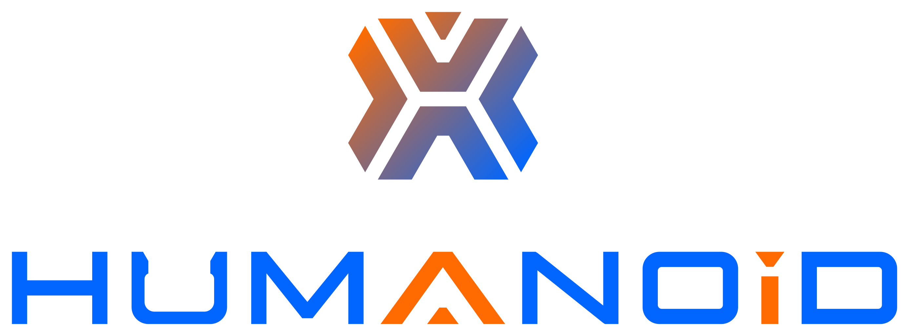

## Hi We are Open X-Humanoid 👋

The Beijing Humanoid Robot Innovation Center was established in November 2023 in Beijing Economic and Technological Development Zone (Beijing Yizhuang). It is the first innovation center in China that focuses on the core technology, product development, and application ecosystem construction of humanoid robots.

# Join Our Open Source Community!​
Calling all developers worldwide! Whatever industry you're from, we'd love for you to contribute to our open source projects for embodied AI. Come help us build and enhance this ecosystem together.

Here’s how you can get involved:

- ​​Explore & Contribute:​​ Dive into our projects. Give them a good try! If you find an issue, tell us. Even better – we'd be thrilled if you submit a PR fix!  
- ​​Partner With Us:​​ Looking to collaborate? Universities and companies – we're open to ideas! If you've got a proposal, reach out and let's talk.

# Open Source Activities
​​Here are our latest open-source activities in the community – stay tuned! 🚀

- [Open Source Software Supply ChainPromotion Plan(OSPP 2025)](https://summer-ospp.ac.cn/org/prodetail/2574e0390?list=org&navpage=org)
- [2025 GLCC](https://www.gitlink.org.cn/glcc/2025/projects)

# Repositories
<table><tbody>

<table class="table table-striped table-bordered table-vcenter"/>
    <tbody>
    <tr><th> Title </th> <th>Description</th>
    <tr>
       <td align="center" > <a href="https://huggingface.co/datasets/x-humanoid-robomind/RoboMIND">RoboMIND V1.0</a></td>
        <td>  a comprehensive dataset featuring 107k real-world demonstration trajectories spanning 479 distinct tasks and involving 96 unique object classes. </a></td>
    <tr>
         <td align="center" > <a href="https://modelscope.cn/collections/X-Humanoid/RoboMIND20">RoboMIND V2.0</a></td>
        <td>Newly added 300,000+ bimanual manipulation trajectories, covering 6 robot embodiments including TienKung;Multi-scenario, multi-task, and multi-skill coverage, comprising 10+ scene setups, 739 tasks, and 129                 skills;Incorporates 8 mainstream model validations including UVA, DP3, PI0.5, and XR-1;12,000+ tactile manipulation data entries to support training of VTLA and MLA models;Applicable for training robot                     "large‑brain and small‑brain" models, enabling long‑horizon collaborative tasks across different robot platforms. </a></td>
    </tr>
    <tr>
         <td align="center" > <a href="https://huggingface.co/collections/X-Humanoid/xr-1">XR-1</a></td>
        <td>We introduce XR-1, a versatile and scalable vision-language-action framework. XR-1 supports robust multi-task learning across diverse robot embodiments and environments.In XR-1, we introduce the Unified Vision-            Motion Codes (UVMC), a discrete latent representation that jointly encodes visual dynamics and robotic motion. XR-1 adopts a three-stage training paradigm to enable precise low-level control across diverse                    robots and tasks.. </a></td>
    </tr>
     <tr>
         <td align="center" > <a href="https://github.com/Open-X-Humanoid/x-humanoid-training-toolchain">x-humanoid-training-toolchain</a></td>
        <td>This project provides a training toolchain for adapting TienKung humanoid robots and RoboMIND dataset with the open-source LeRobot framework. It enables users to facilitates development using RoboMIND dataset and train embodied manipulation models for TienKung robots based on the Lerobot. </a></td>
    </tr>
    <tr>
          <td align="center" > <a href="https://github.com/Open-X-Humanoid/TienKung-Lab">TienKung-Lab</a></td>
        <td> This framework is an RL-based locomotion control system designed for full-sized humanoid robots, TienKung. It integrates AMP-style rewards with periodic gait rewards, facilitating natural, stable, and efficient walking and running behaviors. </a></td>
    </tr>
    <tr>
         <td align="center" > <a href="https://github.com/Open-X-Humanoid/TienKung_URDF">TienKung_URDF</a></td>
        <td>urdf publish is the URDF package for Tien Kung,which includes complete robot description files (URDF) and mesh files(STL), defining core parameters such as mechanical structure, joint limits,and mass distribution.lt supports motion planning and control algorithmverification in the ROS environment and Gazebo simulation platform. </a></td>
    </tr>
     <tr>
          <td align="center" > <a href="https://github.com/Open-X-Humanoid/TienKung_ROS">TienKung_ROS</a></td>
        <td>The Tien Kung software system, developed based on the ROS frameworkis the low-level implementation directly responsible for hardware controlincluding key modules such as body control (body_control),robot description (robot_description), andremote control communication (usb sbus), responsible for the basic motioncontrol and hardware driving of the robot. </a></td>
    </tr>
     <tr>
          <td align="center" > <a href="https://huggingface.co/datasets/x-humanoid-robomind/ArtVIP">ArtVIP</a></td>
        <td> We release a collection of 26 categories, 206 high-quality digital-twin articulated objects.We provide digital-twin scene assets and configured scenarios integrating articulated objects within scene for immediate use.All assets are provided in USD format and are open-source.The detailed production process and standard offer comprehensive guidance to facilitate community adoption and replication. </a></td>
    </tr>
    </tr>
    </tbody>
</table>

# Contact Us
- opensource@x-humanoid.com

# Developer Community

